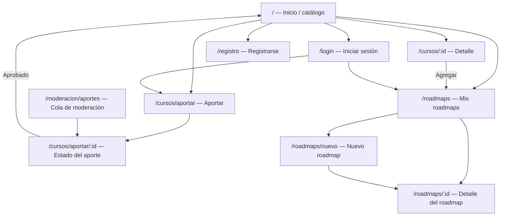

# APPFlow — Roadmap de Cursos (Comunidad)

**Versión:** 1.0 · **Instancia A** · **23/10/2026**

## 1. Mapa de navegación

## 2. Inventario exhaustivo de rutas

| Ruta | Pantalla | Login | API principal |
|---|---|---:|---|
| `/` | Inicio y catálogo comunitario paginado | No | `GET /api/v1/cursos` |
| `/cursos/:id` | Detalle de curso | No para leer; sí para agregar | `GET /api/v1/cursos/{id}`, `POST /api/v1/roadmaps/{roadmap_id}/items` |
| `/cursos/aportar` | Formulario de aporte | Sí | `GET /api/v1/categorias`, `POST /api/v1/aportes` |
| `/cursos/aportar/:id` | Estado y detalle de mi aporte | Sí, autor | `GET /api/v1/aportes/{id}` |
| `/roadmaps` | Lista de roadmaps propios | Sí | `GET /api/v1/roadmaps` |
| `/roadmaps/nuevo` | Crear roadmap | Sí | `POST /api/v1/roadmaps` |
| `/roadmaps/:id` | Timeline y edición de un roadmap propio | Sí, propietario | `GET/PATCH/DELETE /api/v1/roadmaps/{id}`, items |
| `/login` | Inicio de sesión | No | `POST /api/v1/auth/login` |
| `/registro` | Registro | No | `POST /api/v1/auth/registro` |
| `/moderacion/aportes` | Cola de aportes pendientes | Sí, moderador | `GET /api/v1/moderacion/aportes`, `POST .../{id}/decision` |

El menú móvil incluye Inicio, Aportar curso, Mis roadmaps y sesión; Moderación solo aparece para `MODERADOR`.

## 3. Fichas de pantalla

### `/` — Inicio/catálogo

Objetivo: descubrir cursos publicados. Componentes: Navbar, búsqueda, filtro, CourseCard, Pagination, skeleton, empty/error. Estados: carga, resultados, vacío y error con retry. Consume `GET /api/v1/cursos?page=1&limit=20&q=&categoria_id=`.

### `/cursos/:id` — Detalle

Objetivo: evaluar y agregar un curso. Muestra metadatos, flags, enlace externo y CTA. Consume `GET /api/v1/cursos/{id}`; CTA usa `POST /api/v1/roadmaps/{roadmap_id}/items` o redirige a login con retorno. Estados 200, 404 y error de red.

### `/cursos/aportar` — Aporte

Objetivo: enviar una postulación. Formulario: URL, título, categoría, tema, versión, año, docentes, `tiene_cuestionarios`, `requiere_examen`, `otorga_certificado`, `aval_organizacion`, `realizado_por_aportante`. Consume categorías y crea aporte. Error 400/409 mantiene datos y muestra error por campo.

### `/cursos/aportar/:id` — Estado

Objetivo: consultar solo el aporte propio, estado y motivo. Consume `GET /api/v1/aportes/{id}`. Muestra pendiente, publicado o rechazado y permite reenvío solo si el contrato futuro lo habilita; en MVP el rechazo se consulta sin edición automática.

### `/roadmaps` — Mis roadmaps

Objetivo: elegir o crear un roadmap. Consume `GET /api/v1/roadmaps?page=1&limit=20`. Empty state incluye “Crear roadmap” y “Explorar catálogo”. Nunca muestra roadmaps ajenos.

### `/roadmaps/nuevo` — Nuevo roadmap

Objetivo: crear nombre y descripción. Consume `POST /api/v1/roadmaps`; éxito redirige a `/roadmaps/:id`, 400 marca campos, 401 redirige a login.

### `/roadmaps/:id` — Detalle

Objetivo: gestionar el orden personal. Consume roadmap, agrega items, `PATCH` de orden y `DELETE` de items. Timeline con estados loading, empty, saving y error. 403/404 no filtra existencia de roadmaps ajenos.

### `/login` y `/registro`

Formularios accesibles con campos obligatorios, errores inline y retorno a `next` seguro interno. Login crea cookie; logout usa `POST /auth/logout`.

### `/moderacion/aportes`

Solo moderadores. Lista paginada de pendientes, detalle y decisión aprobar/rechazar con motivo obligatorio al rechazar. Consume endpoints de moderación. 403 para cualquier otro rol.

## 4. Flujos de usuario

### Flujo 1 — Descubrir y planificar (US-01, US-02, US-05)

1. Visitante abre `/` y recibe la primera página de cursos publicados.
2. Busca o filtra; si no hay resultados limpia filtros.
3. Abre `/cursos/:id`; si el id no existe ve 404.
4. Pulsa agregar; sin sesión va a `/login?next=/cursos/:id`.
5. Tras login elige un roadmap existente o crea uno en `/roadmaps/nuevo`.
6. El backend verifica publicación y duplicado; la UI confirma, mantiene el detalle y actualiza timeline.

### Flujo 2 — Aportar (US-03)

1. Usuario entra a `/cursos/aportar`; sin sesión se redirige a login.
2. Carga campos y acepta la declaración de realización.
3. La UI valida requeridos, URL y año; el backend vuelve a validar.
4. `POST /api/v1/aportes` crea `PENDIENTE`; duplicado devuelve 409.
5. Se redirige al estado del aporte y se informa que aún no es público.

### Flujo 3 — Moderar (US-04)

1. Moderador abre la cola; solo ve `PENDIENTE`.
2. Revisa enlace y metadatos.
3. Aprueba: `PENDIENTE → PUBLICADO`; rechaza: motivo requerido y `PENDIENTE → RECHAZADO`.
4. La UI confirma y el catálogo refleja la decisión; errores de concurrencia no sobrescriben cambios.

## 5. Estados globales

| Situación | Comportamiento |
|---|---|
| Ruta protegida sin sesión | Redirección a login con `next` interno |
| Sesión expirada | Toast, limpieza de estado y redirección a login |
| Error de red | Banner persistente con reintento, sin borrar datos locales |
| 403 | Pantalla de acceso denegado sin filtrar recursos |
| 404 | Pantalla no encontrada con enlace a catálogo |
