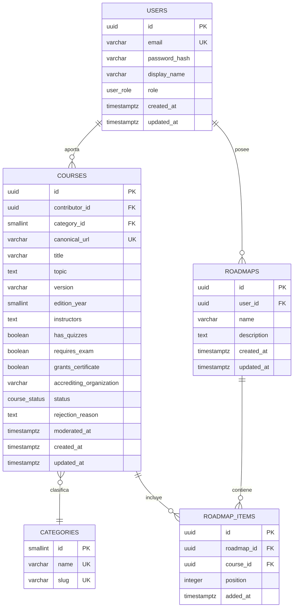
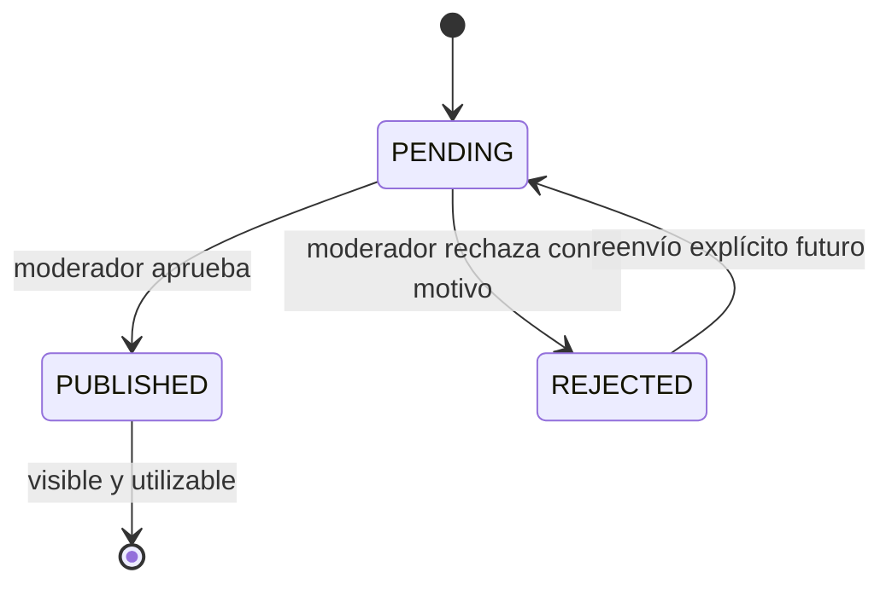

# BackendSchema — Roadmap de Cursos (Comunidad)

**Versión:** 1.0 · **Instancia A** · **23/10/2026**

## 1. Persistencia PostgreSQL 18.6



## 2. Tipos, constraints e índices

```sql
CREATE TYPE user_role AS ENUM ('USER', 'MODERATOR');
CREATE TYPE course_status AS ENUM ('PENDING', 'PUBLISHED', 'REJECTED');
```

| Tabla | Columna | Tipo exacto y constraint |
|---|---|---|
| users | id | `uuid PRIMARY KEY` generado por aplicación |
| users | email | `varchar(320) NOT NULL UNIQUE`, normalizado lowercase |
| users | password_hash | `varchar(255) NOT NULL` |
| users | display_name | `varchar(100) NOT NULL` |
| users | role | `user_role NOT NULL DEFAULT 'USER'` |
| users | created_at/updated_at | `timestamptz NOT NULL DEFAULT now()` |
| categories | id | `smallint GENERATED ALWAYS AS IDENTITY PRIMARY KEY` |
| categories | name/slug | `varchar(80/80) NOT NULL UNIQUE` |
| courses | id | `uuid PRIMARY KEY` |
| courses | contributor_id | `uuid NOT NULL REFERENCES users(id)` |
| courses | category_id | `smallint NOT NULL REFERENCES categories(id)` |
| courses | canonical_url | `varchar(2048) NOT NULL UNIQUE` |
| courses | title | `varchar(200) NOT NULL` |
| courses | topic/version | `text NOT NULL` / `varchar(80) NOT NULL` |
| courses | edition_year | `smallint NOT NULL CHECK (edition_year BETWEEN 1900 AND 2100)` |
| courses | instructors | `text NOT NULL` |
| courses | has_quizzes/requires_exam/grants_certificate | `boolean NOT NULL DEFAULT false` |
| courses | accrediting_organization | `varchar(160) NULL` |
| courses | status | `course_status NOT NULL DEFAULT 'PENDING'` |
| courses | rejection_reason | `text NULL`, obligatorio si `REJECTED` |
| courses | moderated_at | `timestamptz NULL` |
| roadmaps | id/user_id | `uuid PRIMARY KEY`; `uuid NOT NULL REFERENCES users(id) ON DELETE CASCADE` |
| roadmaps | name/description | `varchar(120) NOT NULL`; `text NULL` |
| roadmap_items | id | `uuid PRIMARY KEY` |
| roadmap_items | roadmap_id/course_id | FKs, `ON DELETE CASCADE` para roadmap |
| roadmap_items | position | `integer NOT NULL CHECK (position > 0)` |

**Índices:** `users(email)` y unique de URL/categorías; `courses(status, category_id, id)` para catálogo; `courses(title)` para búsqueda inicial; `courses(contributor_id, status)` para aportes; `roadmaps(user_id, updated_at DESC)`; `roadmap_items(roadmap_id, position)`; unique `(roadmap_id, course_id)` y `(roadmap_id, position)`.

## 3. Ciclo de vida



En el MVP no existe publicación automática. La consulta pública filtra `status = PUBLISHED`.

## 4. Convenciones API

Prefijo `/api/v1`; JSON UTF-8; timestamps UTC ISO 8601. Listados: `page` default 1 y `limit` default 20, máximo 100. Respuesta `{items,total,page,limit,pages}`. Errores `application/problem+json`: `type`, `title`, `status`, `code`, `message`, `details`, `request_id`.

### 4.1 Auth

| Método/ruta | Body | Respuestas |
|---|---|---|
| `POST /auth/registro` | `{email,password,display_name}` | 201 `{user}`; 400 datos inválidos; 409 email existente |
| `POST /auth/login` | `{email,password}` | 200 `{user}` + cookie JWT; 400 formato; 401 credenciales |
| `POST /auth/logout` | vacío | 204; 401 sin sesión |
| `GET /auth/me` | — | 200 `{user}`; 401 sin sesión |

### 4.2 Catálogo

| Método/ruta | Query/body | Respuestas |
|---|---|---|
| `GET /cursos?page=1&limit=20&q=&categoria_id=` | filtros opcionales | 200 paginado; 400 parámetros inválidos |
| `GET /cursos/{id}` | — | 200 curso publicado; 400 id inválido; 404 inexistente/no publicado |
| `GET /categorias` | — | 200 lista; 400 no aplica salvo contrato inválido |

Ejemplo 200:

```json
{"items":[{"id":"uuid","title":"Python","category":{"id":1,"name":"Programación"},"status":"PUBLISHED"}],"total":1,"page":1,"limit":20,"pages":1}
```

### 4.3 Aportes y moderación

| Método/ruta | Body | Respuestas |
|---|---|---|
| `POST /aportes` | `canonical_url,title,category_id,topic,version,edition_year,instructors,has_quizzes,requires_exam,grants_certificate,accrediting_organization,realized_by_contributor` | 201 aporte `PENDING`; 400 validación; 409 URL duplicada |
| `GET /aportes/{id}` | — | 200 si autor; 400 id; 403 ajeno; 404 inexistente |
| `GET /moderacion/aportes?page&limit&status=PENDING` | — | 200 moderador; 400 filtros; 403 rol |
| `POST /moderacion/aportes/{id}/decision` | `{decision:"APPROVE"|"REJECT",reason?:string}` | 200 actualizado; 400 transición/motivo inválido; 404 aporte; 403 rol |

### 4.4 Roadmaps

| Método/ruta | Body/query | Respuestas |
|---|---|---|
| `GET /roadmaps?page&limit` | — | 200 propios paginados; 400 query; 401 |
| `POST /roadmaps` | `{name,description?}` | 201 roadmap; 400 validación; 401 |
| `GET /roadmaps/{id}` | — | 200 propio con items; 400 id; 403/404 |
| `PATCH /roadmaps/{id}` | `{name?,description?}` | 200; 400; 403/404 |
| `DELETE /roadmaps/{id}` | — | 204; 403/404 |
| `POST /roadmaps/{id}/items` | `{course_id,position?}` | 201 item; 400; 403/404 curso; 409 duplicado |
| `PATCH /roadmaps/{id}/items/{item_id}` | `{position}` | 200; 400; 403/404 |
| `DELETE /roadmaps/{id}/items/{item_id}` | — | 204; 403/404 |

## 5. Decisiones de esquema

- Categorías son tabla FK y no enum: se pueden administrar/sembrar sin migrar el tipo de curso.
- Flags son booleanos tipados: son campos consultables y explícitos, no un JSONB opaco.
- `roadmap_items` es tabla intermedia: permite orden, unicidad y futuras propiedades sin duplicar cursos.
- UUID evita enumeración trivial de recursos; autorización siempre verifica propietario además del identificador.
