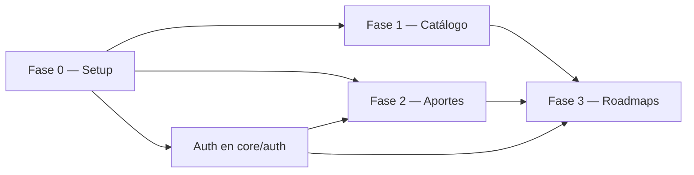

# IMPLEMENTATION_PLAN — Roadmap de Cursos (Comunidad)

**Instancia B planificada:** implementación del MVP · **Dependencias:** [PRD.md](./PRD.md), [TRD.md](./TRD.md), [BackendSchema.md](./BackendSchema.md)

## 1. MVP P0

Debe ser posible ejecutar `docker compose up`, registrarse, iniciar sesión, consultar/paginar el catálogo, abrir un detalle, aportar un curso pendiente, moderarlo y agregarlo/ordenarlo/quitarlo de un roadmap sin errores de consola. Corresponde a US-01 a US-05.

## 2. Dependencias

## 3. Fases y tareas

### Fase 0 — Setup Docker/uv/pnpm (P0)

| ID | Tarea | Dependencia | Hecho cuando |
|---|---|---|---|
| SET-01 | Crear monorepo y árbol Screaming Architecture | — | Existen exactamente los dominios del TRD sin mezclar capas en raíz |
| SET-02 | Configurar Compose con PostgreSQL 18.6 y healthcheck | SET-01 | `docker compose up postgres` queda healthy y acepta conexión |
| SET-03 | Inicializar backend FastAPI con uv, `/health` y manejo RFC 7807 | SET-02 | `GET /health` devuelve 200 y error de prueba tiene content-type problem+json |
| SET-04 | Inicializar React 19/Vite/pnpm, router y shell Navbar | SET-01 | `pnpm dev` abre `/` y el menú móvil funciona por teclado |
| SET-05 | Configurar migraciones, variables y seed idempotente | SET-02, SET-03 | Una base limpia crea tablas y categorías sin duplicar al reiniciar |
| SET-06 | Configurar CI: lint, type-check, tests y Conventional Commits | SET-03, SET-04 | PR falla ante check rojo y pasa ante suite mínima |

### Fase 1 — Catálogo (P0, US-01 y US-02)

| ID | Tarea | Dependencia | Hecho cuando |
|---|---|---|---|
| CAT-01 | Modelar categorías/cursos, constraints e índices | SET-05 | Migración coincide con BackendSchema y test de constraints pasa |
| CAT-02 | Implementar `GET /categorias` y `GET /cursos` con `q`, categoría, `page`, `limit` | CAT-01, SET-03 | Tests cubren default 20, máximo 100, total, vacío y solo PUBLISHED |
| CAT-03 | Implementar `GET /cursos/{id}` | CAT-01 | Publicado devuelve 200; pendiente/ausente devuelve 404 |
| CAT-04 | Construir CourseCard, filtros, estados y Pagination | SET-04, CAT-02 | UI 360 px permite navegar; accesibilidad y estados loading/empty/error cubiertos |
| CAT-05 | Construir detalle `/cursos/:id` | CAT-03, CAT-04 | Muestra todos los metadatos y CTA condicionado por sesión |

### Fase 2 — Aportes y moderación (P0, US-03 y US-04)

| ID | Tarea | Dependencia | Hecho cuando |
|---|---|---|---|
| APR-01 | Implementar usuarios, hash seguro, JWT HttpOnly, registro/login/logout y rol | SET-03, SET-05 | Tests verifican cookie, 401, 403 y contraseña nunca en respuesta/log |
| APR-02 | Modelar aporte como curso PENDING y validar formulario/URL única | CAT-01, APR-01 | POST válido persiste PENDING; duplicado 409; inválidos 400 por campo |
| APR-03 | Implementar `GET /aportes/{id}` y visibilidad por autor | APR-02 | Autor ve estado/motivo; otro usuario recibe 403/404 según política |
| APR-04 | Implementar cola y decisión de moderación transaccional | APR-02, APR-01 | Solo MODERATOR decide; aprueba/rechaza con motivo y transición inválida falla |
| APR-05 | Construir `/cursos/aportar`, estado y `/moderacion/aportes` | APR-02, APR-03, APR-04 | Flujo completo visual con errores, estados y navegación por rol |

### Fase 3 — Roadmaps (P0, US-05)

| ID | Tarea | Dependencia | Hecho cuando |
|---|---|---|---|
| RDM-01 | Crear tablas roadmaps/items, unicidad y posiciones | CAT-01, APR-01 | Migración y tests impiden item duplicado/posición duplicada |
| RDM-02 | Implementar CRUD de roadmaps privado | RDM-01, APR-01 | Usuario solo ve/modifica propios; 403/404 cubiertos |
| RDM-03 | Implementar items: agregar solo PUBLISHED, ordenar y quitar | RDM-01, CAT-03 | 201/200/204; curso no publicado y duplicado retornan error |
| RDM-04 | Construir `/roadmaps`, `/roadmaps/nuevo`, `/roadmaps/:id` y Timeline | RDM-02, RDM-03, SET-04 | Empty/loading/saving/error y reordenamiento persisten al recargar |
| RDM-05 | Integración E2E de US-01 a US-05 y revisión responsive | F1, F2, RDM-04 | Recorrido completo desde base limpia, 360 px y 768 px, sin regresiones |

## 4. Prioridad y orden de ejecución

Todas las tareas listadas son P0 salvo SET-06, que es P1 de habilitación (no agrega funcionalidad, pero bloquea la calidad de integración). Una tarea no se inicia hasta que sus dependencias estén en `done`. Cada tarea se ejecuta en rama GitHub Flow y PR propio o lote coherente.

## 5. Definition of Done

Una tarea está **Done** si:

- cumple exactamente su criterio “Hecho cuando” y actualiza contrato/documentación relacionada;
- tiene tests apropiados (unitarios para services, integración para API/DB y frontend para estados);
- pasa lint, type-check y tests del módulo;
- no introduce código fuera de los dominios del TRD ni secretos;
- tiene manejo explícito de loading, error, vacío y permisos cuando aplica;
- el PR usa Conventional Commit, revisión y evidencia reproducible.

El MVP está Done cuando además: `docker compose up` funciona desde checkout limpio; seed habilita recorrido; todas las historias US-01–US-05 pasan; los cinco flujos P0 tienen pantalla, endpoint y tarea; y la auditoría manual confirma WCAG 2.1 AA básica, menú móvil y paginación.

## 6. Estrategia de testing

| Nivel | Alcance | Umbral |
|---|---|---:|
| Unitario | services: estados, URL, paginación, permisos, posiciones | ≥85% en lógica de dominio |
| Integración | routers + PostgreSQL/Compose, cookies y constraints | 100% de endpoints P0 con casos 200/400/401/403/404/409 aplicables |
| Frontend | componentes y hooks: catálogo, menú, paginador, formularios, timeline | estados principales y teclado |
| E2E | recorrido US-01 a US-05 | cero fallos en ambiente limpio |

## 7. Registro de ejecución

| ID | Estado inicial | Rama/commit a completar |
|---|---|---|
| SET-01–SET-06 | Pendiente de aprobación | `feat/setup` |
| CAT-01–CAT-05 | Pendiente de aprobación | `feat/catalogo` |
| APR-01–APR-05 | Pendiente de aprobación | `feat/aportes-moderacion` |
| RDM-01–RDM-05 | Pendiente de aprobación | `feat/roadmaps` |

## 8. Riesgos y mitigaciones

| Riesgo | Impacto | Mitigación |
|---|---|---|
| Validación de URL externa no garantiza disponibilidad futura | Medio | Verificar en moderación y mostrar fecha/estado; no prometer uptime externo |
| Concurrencia en decisiones de moderación | Alto | Actualización condicional sobre `PENDING` y respuesta de conflicto |
| Reordenamiento inconsistente | Medio | Constraint de posición, transacción y test de dos usuarios/requests |
| Cookie cross-origin en desarrollo | Medio | CORS explícito, `credentials`, `SameSite` documentado y variables por ambiente |
| Scope creep de autenticación | Alto | Mantener fuera de alcance OAuth, recuperación y MFA |
