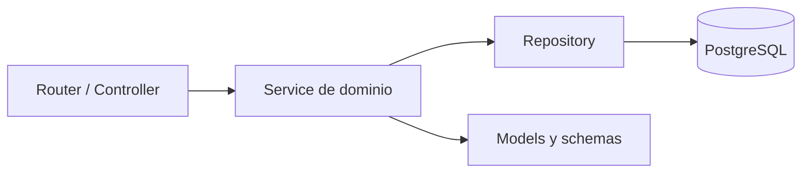
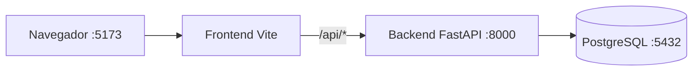

# TRD — Roadmap de Cursos (Comunidad)

**Versión:** 1.0 · **Instancia A** · **23/10/2026**

## 1. Stack

| Capa | Elección | Versión objetivo | Justificación |
|---|---|---|---|
| Frontend | React + Vite + pnpm | React 19; Vite y pnpm fijados en Instancia B | Componentización, routing SPA y desarrollo rápido reproducible |
| Backend | FastAPI + uv | FastAPI y uv fijados en Instancia B | Tipado, validación OpenAPI automática y servidor ASGI |
| Persistencia | PostgreSQL | 18.6 | Integridad relacional, índices, constraints y soporte transaccional |
| Driver/ORM | SQLAlchemy 2.x + psycopg 3 | fijados en Instancia B | ORM tipado y driver PostgreSQL mantenido |
| Infraestructura | Docker + Compose | imagen `postgres:18.6` | Entorno local repetible |

## 2. Decisiones técnicas

| ID | Decisión | Alternativas | Elección y motivo |
|---|---|---|---|
| TD-001 | Autenticación | Sesión server-side, JWT en localStorage, OAuth | JWT firmado en cookie `HttpOnly`, `Secure` fuera de local y `SameSite=Lax`; evita exponer credenciales a XSS y mantiene API stateless. |
| TD-002 | Paginación | Cursor, `page_size`, `page` + `limit` | Offset expresado como `page` + `limit`, con `total` y `pages`; es comprensible para UI académica y uniforme en todos los listados. |
| TD-003 | Errores | Texto libre, envelope propio, RFC 7807 | `application/problem+json` con código estable y detalles por campo; facilita UI, debugging y contratos. |
| TD-004 | Arquitectura | Capas técnicas, microservicios, módulos por dominio | Monolito modular con Screaming Architecture; reduce complejidad y hace visible el negocio. |

## 3. Arquitectura

### 3.1 Capas dentro de cada dominio



Los routers autentican y validan; los services aplican reglas; los repositories son la única puerta de persistencia. No se permite que un router consulte la base directamente ni que un repository decida estados de negocio.

### 3.2 Screaming Architecture obligatoria

```text
roadmap-cursos/
├── backend/
│   ├── pyproject.toml
│   ├── Dockerfile
│   ├── app/
│   │   ├── main.py
│   │   ├── core/              # config, DB, seguridad, errores compartidos
│   │   ├── auth/              # usuarios, login, cookies, permisos
│   │   ├── cursos/            # catálogo y categorías
│   │   ├── aportes/           # postulación y moderación
│   │   └── roadmaps/          # roadmap e items
│   └── tests/
├── frontend/
│   ├── package.json
│   ├── Dockerfile
│   └── src/
│       ├── app/               # router, shell y providers
│       ├── features/
│       │   ├── catalogo/
│       │   ├── roadmaps/
│       │   └── aportar/
│       └── shared/             # Navbar, CourseCard, Pagination, API client
├── docker-compose.yml
└── docs/
```

### 3.3 Servicios Docker

| Servicio | Imagen/base | Puerto | Función |
|---|---|---:|---|
| postgres | `postgres:18.6` | 5432 | Persistencia |
| backend | Python slim + uv | 8000 | API FastAPI |
| frontend | Node + pnpm | 5173 | Vite dev server |



## 4. Cuatro prácticas mandatarias

1. **Screaming Architecture:** los módulos son `cursos`, `roadmaps`, `aportes`, `auth` y `core`; dentro de cada dominio se mantienen router/service/repository/models.
2. **Mobile-first:** layout base de 360 px sin media queries; `@media (min-width: 768px)` agrega grid, navegación horizontal y densidad; no se “arregla” desktop con parches posteriores.
3. **Paginación uniforme:** cada listado de cursos y roadmap acepta `page` y `limit`, valida límites y devuelve la misma forma paginada.
4. **Menú hamburguesa:** Navbar colapsada en móvil, accesible por teclado, con foco administrado; a partir de 768 px se muestra la navegación horizontal.

## 5. Convenciones operativas

- **GitHub Flow:** `main` protegida; cada cambio sale de `main` en una rama corta (`feat/catalogo`, `fix/auth-cookie`, `docs/instancia-a`), abre PR, pasa revisión y checks, y se integra con squash merge. No se trabaja directamente sobre `main`.
- **Conventional Commits:** `feat:`, `fix:`, `docs:`, `test:`, `refactor:`, `chore:`, `docker:`.
- **Variables:** `DATABASE_URL` (obligatoria), `JWT_SECRET` (obligatoria y secreta), `JWT_EXPIRES_MINUTES` (default documentado), `CORS_ORIGINS` (obligatoria en despliegue).
- **Logging:** se registran método, ruta, status, duración, request id y errores sanitizados; nunca contraseñas, JWT, cookies completas ni datos sensibles.
- **Excepciones:** dominio produce errores tipados; una capa central los transforma a RFC 7807. No se silencian excepciones inesperadas.

## 6. ADRs

### ADR-001 — JWT en cookie HttpOnly

**Contexto:** el frontend necesita sesión sin exponer el token a JavaScript.  
**Decisión:** JWT firmado en cookie `HttpOnly`, `SameSite=Lax`; `Secure` en HTTPS. El backend valida cookie y autorización por rol.  
**Consecuencia:** se evita `localStorage`, pero mutaciones deben validar origen/CSRF y logout revoca por expiración o denylist si se incorpora más adelante.

### ADR-002 — Paginación por página y límite

**Contexto:** el catálogo necesita navegación directa y total de resultados.  
**Decisión:** `page` inicia en 1, `limit` default 20, máximo 100; SQL usa `LIMIT/OFFSET` y devuelve `total/pages`.  
**Consecuencia:** contrato simple y uniforme; para volúmenes masivos futuros se evaluará cursor sin cambiar la semántica de la UI del MVP.

### ADR-003 — RFC 7807 para errores

**Contexto:** el frontend necesita distinguir autenticación, autorización, conflictos y errores por campo.  
**Decisión:** `application/problem+json` con `type`, `title`, `status`, `code`, `message`, `details`, `request_id`.  
**Consecuencia:** errores consistentes y testeables; el cliente no interpreta mensajes libres para decidir lógica.

## 7. Verificación de requisitos

| Requisito | Evidencia |
|---|---|
| Paginación | [BackendSchema.md](./BackendSchema.md) §3.2 y §3.4; tareas CAT-02 y RDM-03 del plan |
| Mobile-first | [UX-UI.md](./UX-UI.md) §3 |
| Menú hamburguesa | [UX-UI.md](./UX-UI.md) §4.4 y [APPFlow.md](./APPFlow.md) §2 |
| Ciclo de aportes | [BackendSchema.md](./BackendSchema.md) §2; tareas APR-02/03 |
